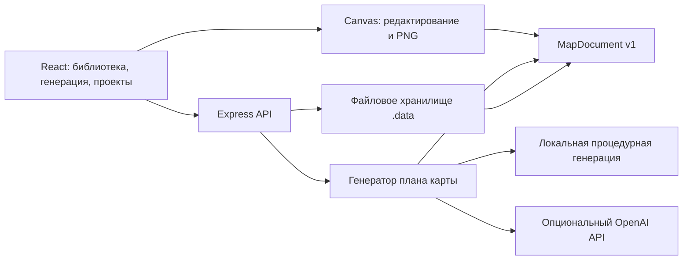

# Архитектура DungeonAI Studio

Версия 1 создаёт мастерскую для тактических карт и отделяет внутренний формат от форматов Dungeondraft. Исходный HTML-прототип 0.1 из `main` сохранён без изменений в `public/legacy/index.html` для прежних проектов и инструментов.

## Компоненты

- `shared/types.ts`: единый контракт. Все координаты измеряются в клетках. `MapDocument` содержит версию, размеры, тему, исходное описание, seed и массив редактируемых элементов. `floorAssetId` задаёт PNG-текстуру помещения/коридора, `wallAssetId` — общего периметра, `WallElement.assetId` — отдельной стены. `shared/assets.ts` собирает все ссылки для сохранения и экспорта.
- `shared/validation.ts`: проверка версии, идентификаторов, границ карты, типов и числа элементов. Проверка выполняется на сервере независимо от интерфейса.
- `shared/localGenerator.ts`: генерация с воспроизводимым seed, общая для браузера и сервера. `server/generator.ts` сохраняет серверные экспорты и отдельный адаптер ИИ. Ассеты берутся из реальной библиотеки. Отсутствующий ключ или ошибка провайдера возвращаются как ошибка, а не выдаются за успешную ИИ-генерацию.
- `server/storage.ts`: PNG и метаданные ассетов; JSON проектов. Атомарная запись через временный файл. Большие импорты используют дисковые временные файлы; весь набор появляется в каталоге после атомарного маркера завершения. Общая очередь мутаций защищает проверку ссылок при удалении ассета.
- `server/app.ts`: импорт, библиотека, проекты, генерация и проверка доступных возможностей. PNG декодируется с проверкой CRC; ZIP читается с ограничением размера и количества записей.
- `src/MapCanvas.tsx`, `src/mapRenderer.ts`: общий отрисовщик для редактора и PNG. Периметр объединённых помещений и коридоров формируется автоматически; ручные стены — отдельные элементы.
- `src/App.tsx`: состояние документа, история отмены, инструменты, свойства выделения, библиотека и диалоги сохранения/экспорта.
- `src/browserApi.ts`: тот же контракт операций для GitHub Pages, но с IndexedDB вместо HTTP. Транзакции проверяют ссылки и сохраняют изменения между вкладками; изображения хранятся как Blob. Схема IndexedDB v2 сохраняет прежние данные v1 и добавляет временный store импорта; проверенные PNG записываются по одному, затем публикуются одной транзакцией. ZIP читается через `Blob.slice` без загрузки всего архива в память. `src/pngValidation.ts` проверяет PNG и CRC.
- `shared/importLimits.ts`: общие лимиты и сообщения для браузера, сервера и интерфейса. Рендерер использует очередь из двух загрузок и ограниченный кэш неактивных оригиналов; библиотека и PNG-селекторы ограничивают число отображаемых элементов.

Режим задаётся при сборке `VITE_STORAGE_MODE=browser`. Обычная сборка сохраняет серверное поведение. Браузерная сборка не импортирует серверный ИИ, не отправляет данные в `/api` и не требует внешних шрифтов. Базовый путь сайта задаёт `VITE_BASE_PATH`; `build:pages` использует `/DungeonAI-Studio/`.

## Хранение и форматы

Сервер хранит ассеты в `.data/assets`, проекты в `.data/projects`. Каталог задаётся `DUNGEON_DATA_DIR` и должен сохраняться между запусками. Удаление ассета, используемого сохранённым проектом, запрещено. Проект с отсутствующей ссылкой на ассет не сохраняется.

| Формат | Статус и назначение |
| --- | --- |
| PNG | Импорт ассета и растровый экспорт карты |
| ZIP с PNG | Импорт изображений из распакованного пользователем набора; остальные записи пропускаются с предупреждением |
| `.dungeonai.json` | Собственный редактируемый документ; изображения остаются в библиотеке сервера |
| `.dungeondraft_pack` | Бинарный импорт не реализован и явно отклоняется |
| `.dungeondraft_map` | Экспорт не реализован; совместимость не заявляется |

PNG категории «Полы» и «Стены» применяются как повторяемые текстуры; генератор использует первый выбранный PNG каждой категории. PNG категории «Объекты» размещаются отдельно с сохранением пропорций. Прозрачная текстура накладывается на основной материал. Текстуры участвуют в проверке ссылок при сохранении, удалении и экспорте.

## Развитие интеграции Dungeondraft

Нативные форматы должны подключаться через отдельные адаптеры, не меняя модель редактора. До включения поддержки необходимы образцы файлов, проверка распаковки настоящего пакета, соответствие координат/уровней/ссылок на ассеты и открытие экспортированной карты в Dungeondraft. Круговая проверка «импорт → экспорт → открытие» обязательна; переименование JSON в `.dungeondraft_map` не является экспортом.

## Проверка

`npm test` проверяет генератор и API на реальных файловых операциях и HTTP-запросах. `npm run test:e2e` проверяет взаимодействие в Chromium, сохранение и скачивание PNG. `npm run build` включает проверку типов и сборку интерфейса. Интеграция с внешним ИИ требует отдельной проверки с доступным ключом; тесты адаптера используют контролируемый ответ провайдера.
